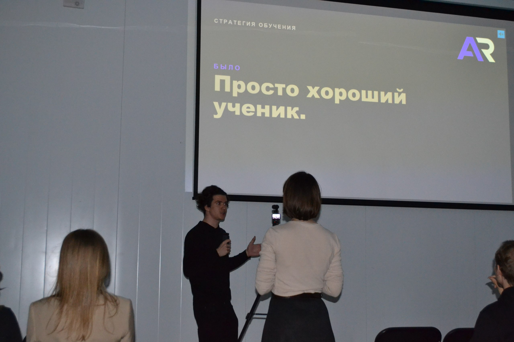
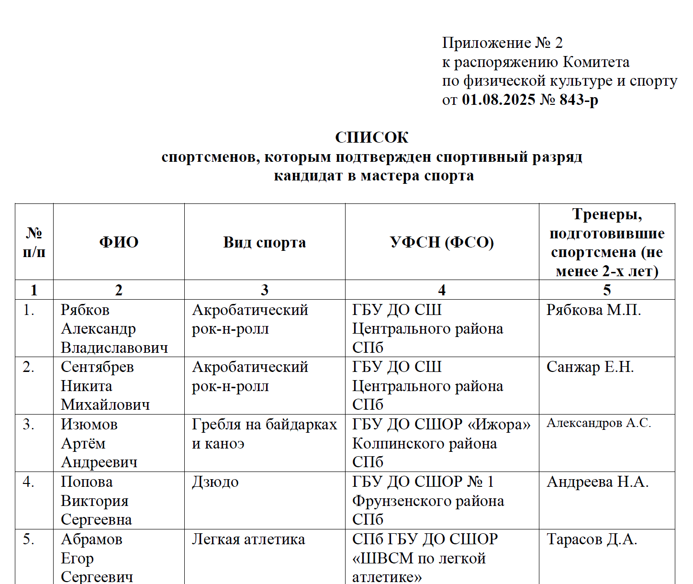
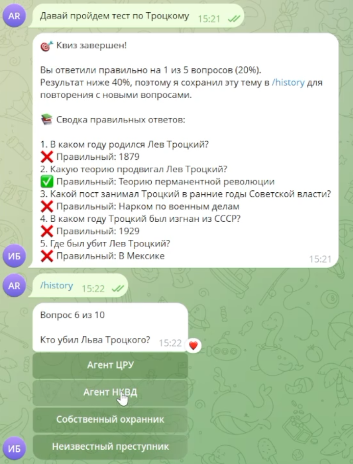
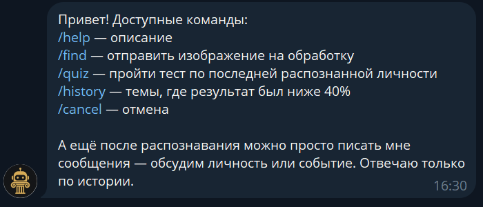
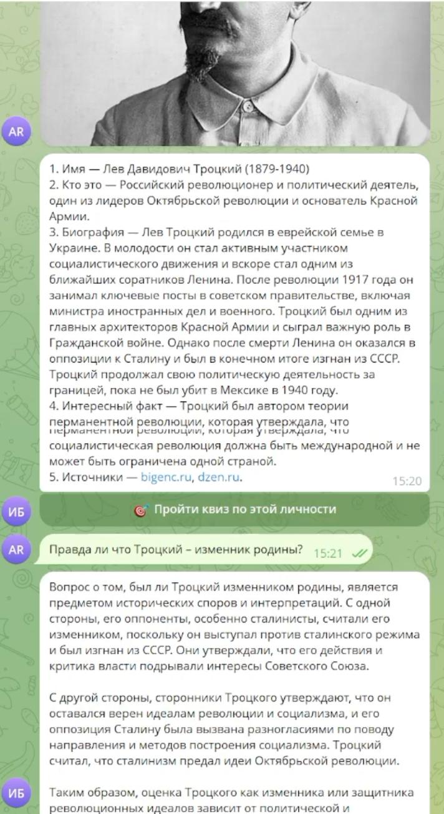

# Культурно-творческие достижения

## Музыкальное творчество
Создание коммерческих фонограмм для спортсменов (акробатический рок-н-ролл): адаптирую и записываю треки под хореографию для музыкального сопровождения выступлений

Веду телеграмм-канал, посвященный музыке, где публикую свои работы

*Ссылка: [телеграм](https://t.me/ARmusicRnR)*

## Спикер на серии мероприятий «Долой Уныние», посвященных поиску себя

Мероприятия проводятся в коворкинге «ПРОСТО».

## Спорт
Кандидат в мастера спорта по акробатическому рок-н-роллу (танцевальная дисциплина со сценическими выступлениями).
Разряд подтвержден официальным приказом (лето 2025). Активно тренируюсь, участвую в соревнованиях и показательных выступлениях.  

*Превью: *
*Приказ: [приказ](pdf/Приложение_2_к_распоряжению_КФКиС_от_01_08_2025_843_р_Подтверждение.pdf)*

## Творчество в ИТМО 
Участник в развитии «клуба любителей Minecraft ИТМО». Рассматриваю это, как площадку для развития креативности и командных проектов. Проведение мероприятий как в ИТМО, так и на серверах игры, ассистирование в ведении социальных сетей, построение плана развития клуба

## ИИстория. Популяризационный проект по истории

Популяризационный проект по истории: Telegram-бот, который по портрету распознаёт историческую личность (обратный поиск + мультимодальная LLM), рассказывает её биографию и проводит квизы с повторением слабых тем. [Github](https://github.com/AR-git-hub/AI-History-tgbot)

