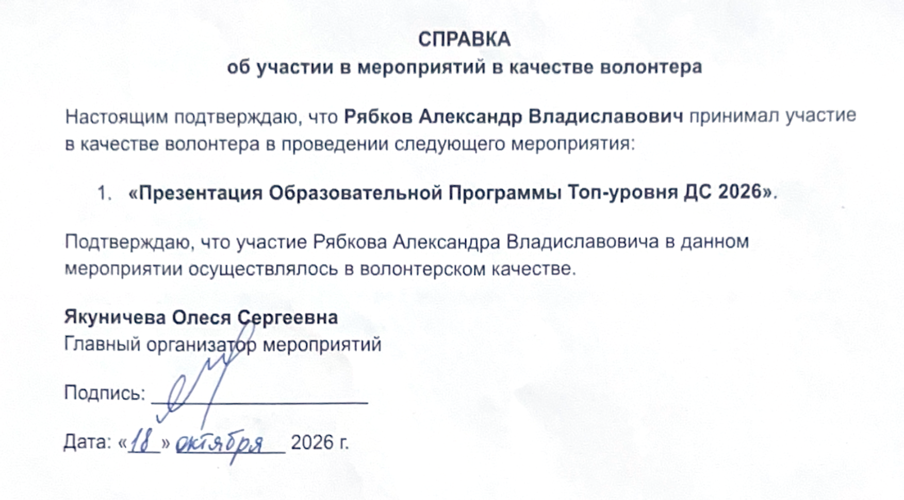
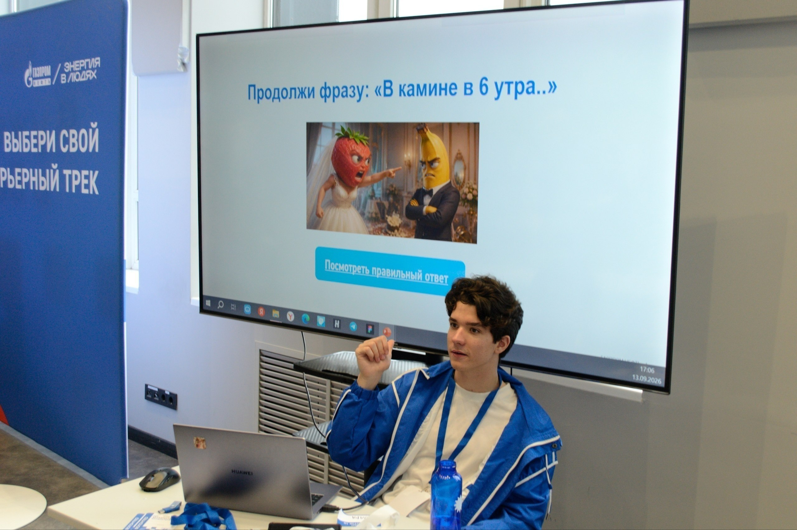
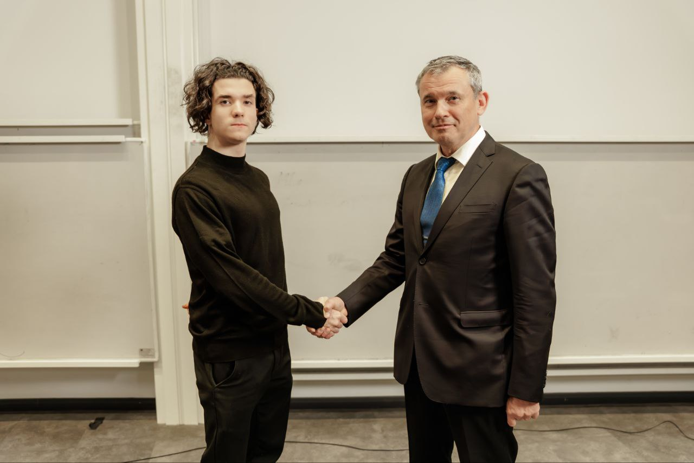
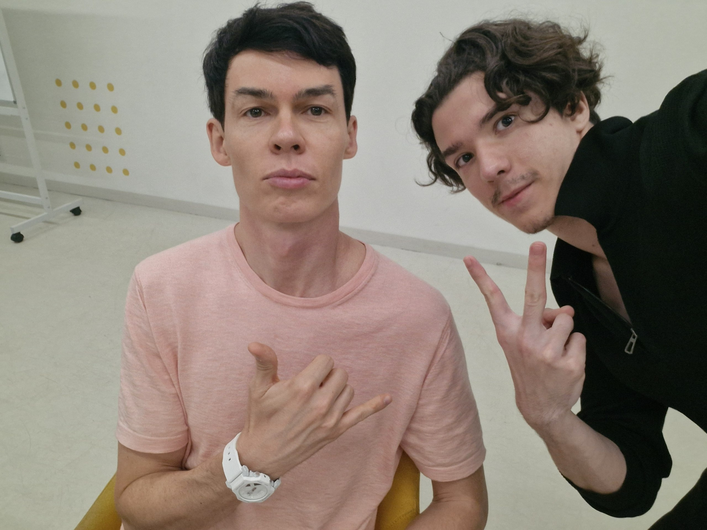
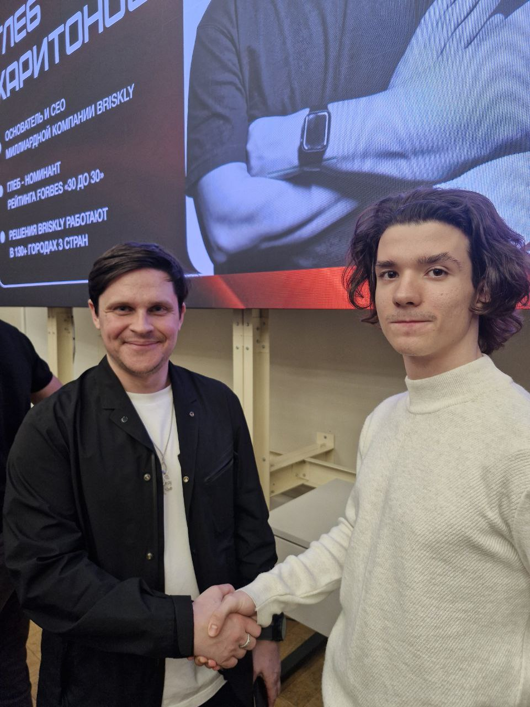
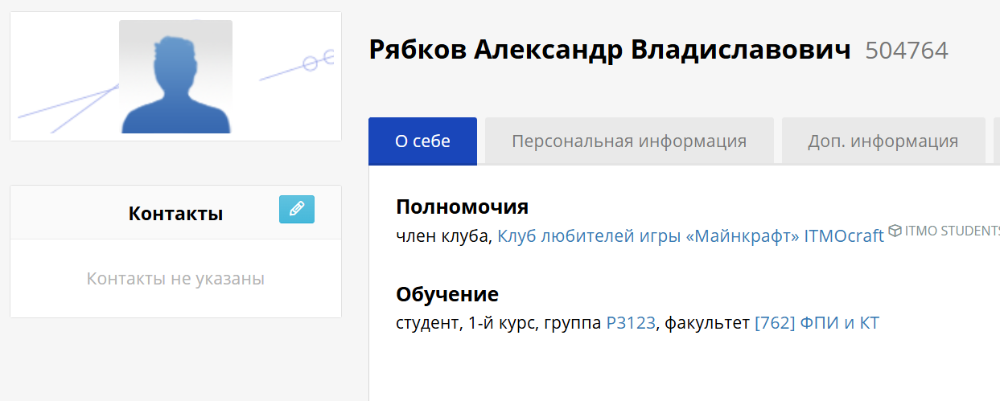
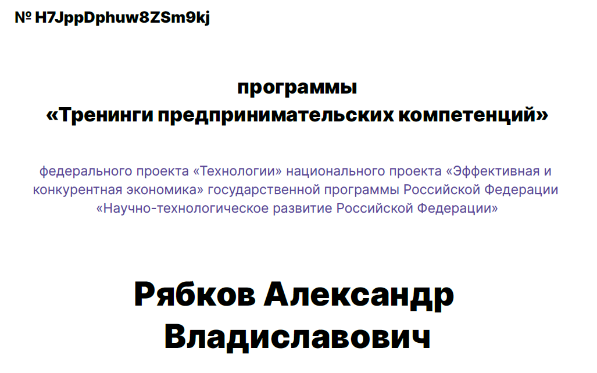

# Общественная и организаторская деятельность

## Волонтерство

- Станция ГПН на вселенной ИТМО в КСК арене (ведущий стенда)

*Превью: *

- Станция ГПН на открытии спецтрека ДС (ведущий активности «Своя Игра»)

- Проведение мероприятий по адаптации студентов первых курсов (консультирование первокурсников по вопросам учебы, карьеры, университета; проведение ознакомительно-развлекательных мероприятий таких как «Модуль ИТМО», «Нейроквест» и др.).

## Участие в студенческих сообществах
- **ITMO BUSINESS COMMUNITY** – член сообщества, участие в нетворкинге, встречи с приглашенными предпринимателями

Альберт Суфияров (CEO "Нева Милк"): 
Олег Торбосов (CEO основатель WhiteWill, автор телеграм канала (https://t.me/TorbosovLife) с аудиторией 100k+): 
Глеб Харитонов (CEO "Briskley"): 

- **Клуб любителей Minecraft ИТМО** – активное участие в развитии клуба: организация встреч, привлечение новых участников, проведение игровых сессий и обсуждений 

## Дополнительные компетенции
- Лучший стартап и его презентация в «Тренинге предпринимательских компетенций ИТМО» в рамках обучения на курсе Коммуникации и Командообразование – лидер команды победителей (Тренинг Предпринимательских Компетенций
«Деловая игра «Технологические лидеры» (13.04.2026 Университет
ИТМО / ИТМО-к) 2»)
*Превью: *
[Сертификат](pdf/https___study-techtraining.mipt.ru_api_v1_files_StRykhkWRf4CzHJ78.pdf)

## Посещение конференций и мероприятий
Регулярное участие в конференциях и митапах, в том числе:
  - Scientific Open Source Meetup
  - Спецтрек ДС – посещение всех встреч и успешное взаимодействие с организаторами спецтрека

## Лидерские позиции

- **Тимлид команды победителей** на хакатоне от ГПН. Руководил разработкой продвинутого pdf-парсера: роутинг с помощью Docling LayoutPredictor в VLM (Llama 3.2 11B Vision) & EasyOCR.
- **Тимлид разработки MAS** для CatBoost feature-engineering. [GitHub](https://github.com/AR-git-hub/AI-agent-for-Feature-Engineering).
- **Тимлид разработки MAS** для ассистирования работы химика-органика в научной лаборатории. [Sourcecraft](https://sourcecraft.dev/chem-mas-assistant/langgraphmas).
- **Тимлид на хакатоне «Нефтекод» от Газпромнефти** – руководил командой и развернул сложную DeepSets-подобную set-модель для предсказания 2 регрессионных целей DOT (химический анализ). [GitHub](https://github.com/AR-git-hub/Chemistry-Daimler-Oxidation-Prediction).
- **Тимлид на хакатоне PochtaTech от Почты России** – управлял процессом создания ML-сервиса по автоматизации разбора обращений в техподдержку. Функционал: классификация на 15 видов, маршрутизация на линию поддержки, прогноз SLA, поиск похожих кейсов, аналитические BI-инструменты по письмам и работе сервиса. [GitHub](https://github.com/AR-git-hub/Pochtatech-Hackathon)
- **Тимлид на хакатоне AI Science Hack от Норникеля** – руководил командой для создания комплексного сервиса по обоснованной генерации технологических гипотез по имеющемуся корпусу знаний (генеративная СППР). [GitHub](https://github.com/AR-git-hub/Scientific-Discovery-MAS-Metallurgy.git).
- **Тимлид проекта по разработке сайта для финансового учета с CRM** – управлял процессом создания веб-приложения на Flask, включая backend и frontend. Организовывал работу, контролировал дедлайны, вел коммуникацию.
- **Тимлид на хакатоне ГПН** – руководил командой при обучении BERT для классификации корпоративных писем. Координировал задачи, распределял роли, отвечал за итоговую презентацию. Оценка проекта: 5.0 (100 баллов)
[GitHub](https://github.com/AR-git-hub/GPN_Hackaton_ARTeam)

